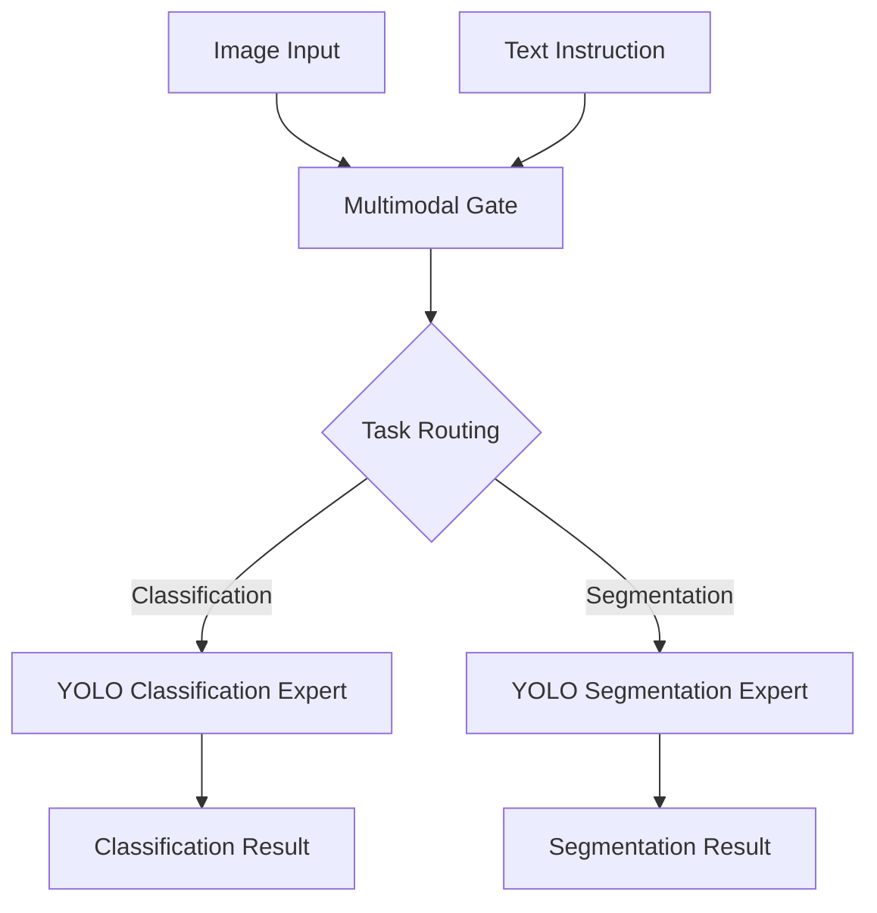
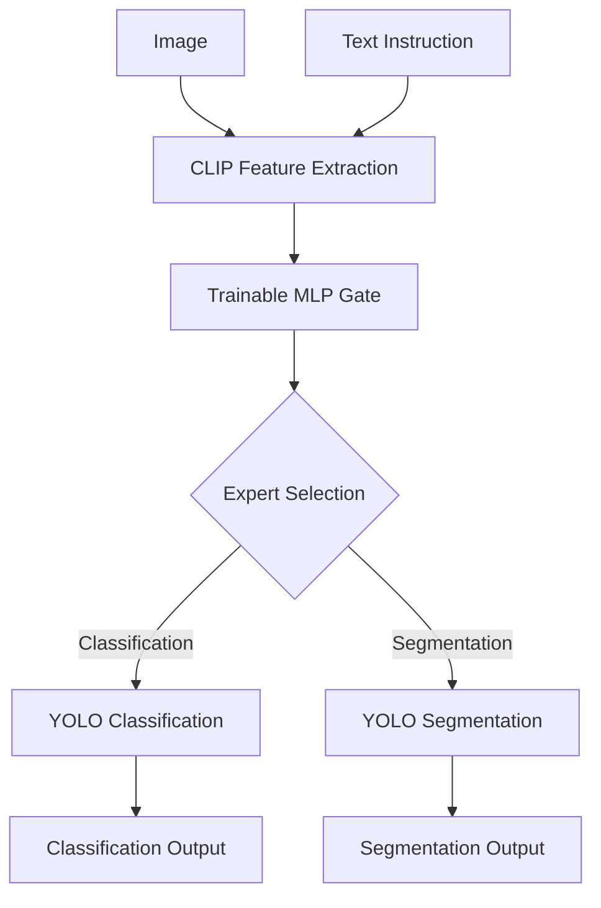
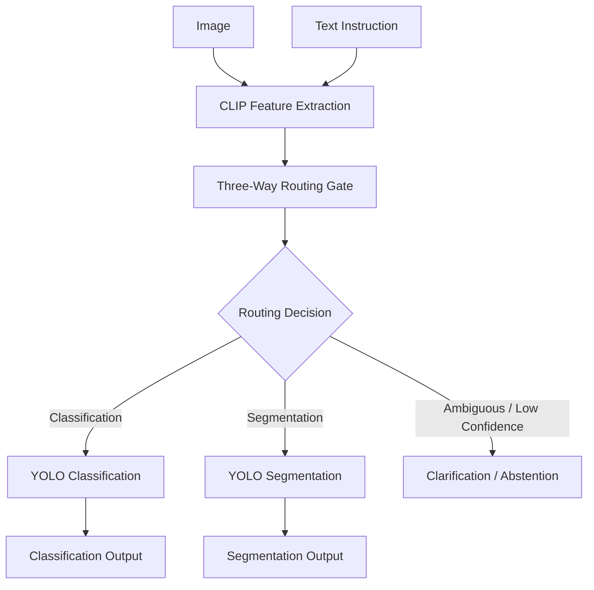
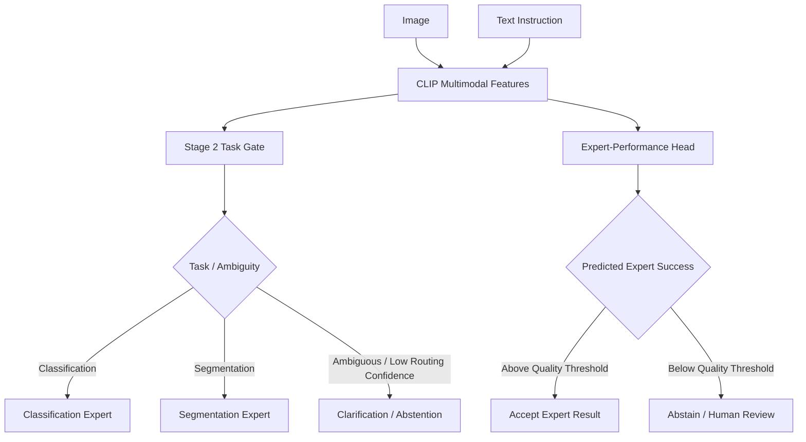

# MoE-cls-seg

A multimodal **Mixture of Experts (MoE)** system that accepts an image and a natural-language instruction, interprets the requested task, and routes the input to the appropriate vision expert.

The project combines CLIP-based multimodal feature extraction with specialized YOLO models for image classification and segmentation. It is developed progressively across three stages, moving from basic task-based routing to confidence-aware and expert-performance-aware decisions.

---

## Project Overview

The system consists of three main components:

- **Multimodal Gate:** Processes image and text features to determine the requested task.
- **Classification Expert:** A YOLO classification model that predicts the category or breed in an image.
- **Segmentation Expert:** A YOLO segmentation model that identifies and segments objects in an image.

As the project progresses, the routing system gains the ability to recognize ambiguous requests, estimate routing confidence, and predict whether the selected expert is likely to produce a successful result.

## Overall Architecture



---

## Project Structure

```text
MoE-cls-seg/
│
├── Multimodal_MoE_Tutorial.ipynb
├── Stage2_Confidence_Aware_MoE.ipynb
├── Stage3_Expert_Performance_Aware_MoE.ipynb
│
├── moe_inference.py
├── moe_confidence_inference.py
│
├── artifacts/
│   ├── classification_best.pt
│   ├── segmentation_best.pt
│   ├── router.pt
│   ├── router_confidence_aware.pt
│   ├── moe_confidence_config.json
│   ├── router_performance_aware.pt
│   └── moe_performance_aware_config.json
│
└── README.md
```

The `artifacts/` directory contains the trained model checkpoints and configuration files generated throughout the notebooks. Exact contents depend on which stages have been executed.

---

# Stage 1 – Multimodal Task-Based Routing

**Notebook:** `Multimodal_MoE_Tutorial.ipynb`

Stage 1 introduces the fundamental Mixture of Experts architecture. The model receives an image and a text instruction, extracts multimodal features using CLIP, and uses a trainable gating network to select the appropriate YOLO expert.

### Functionality

- Uses pretrained CLIP to extract image and text embeddings.
- Combines multimodal features and passes them through a trainable MLP gate.
- Trains the gate to distinguish between classification and segmentation requests.
- Uses two independent YOLO models as task-specific experts.
- Routes each request to the selected expert.
- Saves the gate and expert checkpoints for reuse.
- Demonstrates inference and segmentation visualization.

### Architecture



### What You Will Learn

- Fundamentals of Mixture of Experts architectures.
- Multimodal feature extraction using CLIP.
- Combining image and text representations.
- Training a gating network for task selection.
- Integrating independently trained vision models.
- Saving and loading model checkpoints.
- Performing inference using a unified model interface.

### Main Outputs

- `router.pt` – trained multimodal gating network.
- `classification_best.pt` – trained YOLO classification expert.
- `segmentation_best.pt` – trained YOLO segmentation expert.

---

# Stage 2 – Confidence-Aware Routing

**Notebook:** `Stage2_Confidence_Aware_MoE.ipynb`

Stage 2 extends the original architecture by introducing confidence-aware routing and an explicit clarification mechanism.

Instead of always selecting an expert, the gate can now recognize ambiguous instructions and abstain from making a routing decision.

The Stage 1 experts are reused, while the original two-output gate is expanded to support three routing decisions.

### Routing Decisions

| ID | Decision | Description |
|---|---|---|
| 0 | Classification | Route to the YOLO classification expert. |
| 1 | Segmentation | Route to the YOLO segmentation expert. |
| 2 | Clarification | Abstain because the request is ambiguous. |

### Functionality

- Reuses the pretrained Stage 1 CLIP encoder and gating network.
- Expands the routing head from two outputs to three.
- Fine-tunes the gate using classification, segmentation, and ambiguous instructions.
- Applies temperature scaling to calibrate routing probabilities.
- Evaluates routing accuracy, negative log-likelihood (NLL), and Expected Calibration Error (ECE).
- Plots reliability diagrams to inspect calibration.
- Introduces confidence thresholds for selective routing.
- Inspects the selected YOLO expert's output confidence as a separate quality signal.
- Saves the confidence-aware router and its configuration.

### Architecture



### What You Will Learn

- Why confidence matters in routing systems.
- How to introduce abstention into an MoE architecture.
- How to extend a pretrained gating network.
- How temperature scaling works.
- How to evaluate probability calibration using ECE and NLL.
- How confidence thresholds affect coverage and accepted accuracy.
- How to distinguish routing confidence from expert-output confidence.

### Main Outputs

- `router_confidence_aware.pt` – three-way confidence-aware routing checkpoint.
- `moe_confidence_config.json` – routing and calibration configuration.

The Stage 1 YOLO expert checkpoints remain unchanged.

---

# Stage 3 – Expert-Performance-Aware Routing

**Notebook:** `Stage3_Expert_Performance_Aware_MoE.ipynb`

Stage 3 introduces an additional level of decision-making: predicting whether the selected expert is likely to produce a successful result.

Stage 2 estimates whether the task request is clear and whether the routing decision is sufficiently confident. Stage 3 builds on this by learning from the actual observed outcomes of the YOLO experts.

A new expert-performance prediction head is added to the Stage 2 architecture. It estimates the probability of success for the expert associated with the requested task.

### Functionality

- Reuses the Stage 1 YOLO classification and segmentation experts.
- Loads the Stage 2 confidence-aware routing gate.
- Runs both experts against images with available ground-truth annotations.
- Generates task-specific success labels:
  - Classification success is based on top-1 prediction correctness.
  - Segmentation success is based on foreground Intersection over Union (IoU) meeting a configured threshold.
- Adds a two-output expert-performance prediction head.
- Trains the new head using observed expert outcomes.
- Keeps CLIP and the Stage 2 task-routing gate frozen.
- Evaluates quality prediction using Brier score and Expected Calibration Error (ECE).
- Generates reliability diagrams for predicted expert success.
- Studies the relationship between quality thresholds, coverage, and accepted success rate.
- Combines Stage 2 routing confidence with predicted expert success in the final inference policy.

### Architecture



### How Stage 3 Works

The inference policy applies two sequential checks:

**1. Task and routing confidence**

The Stage 2 gate determines whether the request is classification, segmentation, or ambiguous. Requests that are ambiguous or have insufficient routing confidence are rejected for clarification.

**2. Predicted expert performance**

For a clear task, the Stage 3 performance head estimates the probability that the corresponding expert will meet its task-specific success criterion.

- If predicted success is above the configured quality threshold, the request is accepted and sent to the selected expert.
- If predicted success is below the threshold, the system abstains and marks the request for review.

The system does not silently switch to the other expert when predicted performance is low.

### What You Will Learn

- How to evaluate expert performance using ground-truth annotations.
- How to generate task-specific success and failure labels.
- How to train an auxiliary prediction head.
- How to predict the probability of expert success.
- How to evaluate probability predictions using Brier score and ECE.
- How to interpret reliability diagrams.
- How to analyze the trade-off between coverage and accepted success rate.
- How to combine task routing, routing confidence, and predicted expert performance.

### Main Outputs

- `router_performance_aware.pt` – Stage 2 routing gate combined with the trained expert-performance head.
- `moe_performance_aware_config.json` – model, expert, and threshold configuration.

The Stage 1 YOLO checkpoints remain unchanged and are reused.

---

## Comparison Across Stages

| Feature | Stage 1 | Stage 2 | Stage 3 |
|---|:---:|:---:|:---:|
| Image and text input | Yes | Yes | Yes |
| CLIP feature extraction | Yes | Yes | Yes |
| YOLO classification expert | Yes | Yes | Yes |
| YOLO segmentation expert | Yes | Yes | Yes |
| Task-based routing | Yes | Yes | Yes |
| Ambiguity detection | No | Yes | Yes |
| Confidence-aware abstention | No | Yes | Yes |
| Temperature scaling | No | Yes | Reuses Stage 2 |
| Expert-output confidence inspection | Yes | Yes | Yes |
| Ground-truth expert outcome evaluation | No | Separate evaluation | Yes |
| Expert-performance prediction head | No | No | Yes |
| Quality-based abstention | No | No | Yes |
| Coverage and selective success analysis | No | Yes | Yes |

---

## Inference

The project includes standalone Python modules for running inference outside Jupyter notebooks.

| File | Purpose |
|---|---|
| `moe_inference.py` | Loads the Stage 1 gate and YOLO experts for task-based inference. |
| `moe_confidence_inference.py` | Loads the Stage 2 confidence-aware gate and YOLO experts for confidence-aware inference. |

Stage 3 inference is demonstrated within `Stage3_Expert_Performance_Aware_MoE.ipynb`. Its saved checkpoint and configuration can be used as the basis for a standalone deployment wrapper.

---

## Installation and Execution

The notebooks are designed to run on:

- Google Colab
- Linux
- Windows
- macOS

### Hardware Support

The notebooks automatically detect the available compute device:

| Hardware | PyTorch Device |
|---|---|
| NVIDIA GPU | CUDA |
| Apple Silicon GPU | MPS |
| CPU | CPU |

Google Colab users can optionally mount Google Drive to persist datasets, checkpoints, and generated artifacts between sessions.

### Recommended Execution Order

Run the notebooks in sequence:

1. `Multimodal_MoE_Tutorial.ipynb`
2. `Stage2_Confidence_Aware_MoE.ipynb`
3. `Stage3_Expert_Performance_Aware_MoE.ipynb`

Each stage builds on artifacts generated by the previous stages. Ensure the required checkpoints are available in the configured `artifacts/` directory before proceeding.

---

## Important Limitations

- **Stage 1:** The gate primarily learns to recognize the requested task from image and text features. It does not learn to compare the actual performance of the experts.
- **Stage 2:** Ambiguity handling is trained using supervised prompt labels. The system does not independently establish whether an instruction is ambiguous in every possible real-world situation.
- **Stage 2:** Classification confidence and segmentation confidence are task-specific signals and should not be treated as directly comparable.
- **Stage 3:** The performance head predicts whether the selected expert will meet a defined task-specific success criterion. It does not compare the two experts as interchangeable alternatives.
- **Stage 3:** Classification and segmentation use different success definitions: top-1 correctness and foreground IoU, respectively.
- **Dataset:** The Oxford-IIIT Pet test split has been used during earlier development stages for expert checkpoint selection and routing calibration/evaluation. Consequently, the later-stage results are intended as a progressive learning demonstration rather than a pristine independent benchmark.
- **Thresholds:** Routing and quality thresholds are operating choices. Their values should be evaluated against the intended application and the desired balance between coverage and reliability.

---

## Learning Outcomes

By completing all three stages, you will gain practical experience with:

1. Multimodal learning using image and text inputs.
2. CLIP-based feature extraction.
3. Mixture of Experts architecture and task-specific routing.
4. Integration of YOLO classification and segmentation models.
5. Confidence-aware routing and abstention.
6. Probability calibration using temperature scaling.
7. Expert-performance prediction using observed outcomes.
8. Brier score, Expected Calibration Error, and reliability diagrams.
9. Selective prediction and coverage analysis.
10. Saving, loading, and reusing trained model checkpoints.

---

## Conclusion

This project demonstrates the progressive development of a multimodal Mixture of Experts system.

Starting with task-based routing in Stage 1, it introduces confidence-aware decisions and abstention in Stage 2, and finally learns to estimate task-specific expert performance in Stage 3.

Together, the three stages provide a practical exploration of multimodal routing, specialized vision models, confidence calibration, and performance-aware decision-making.