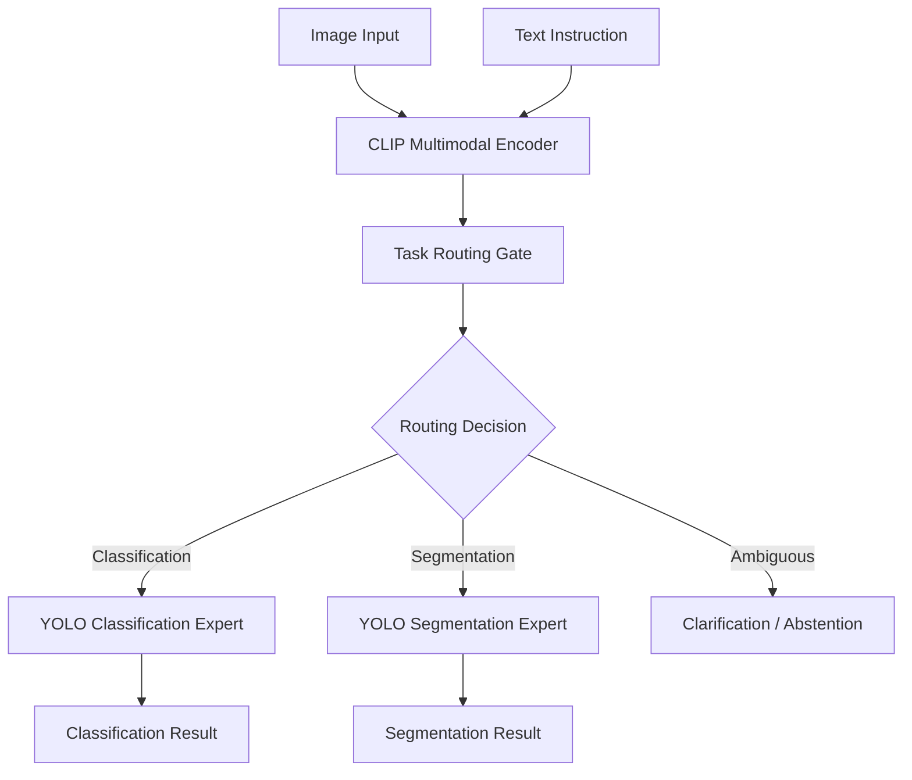
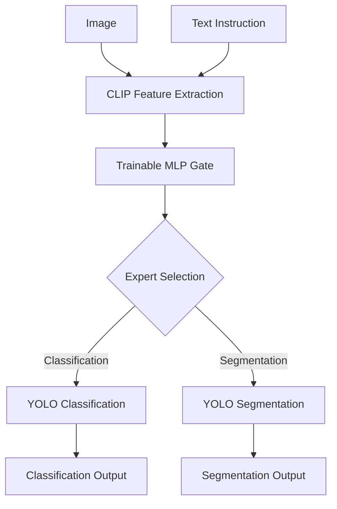
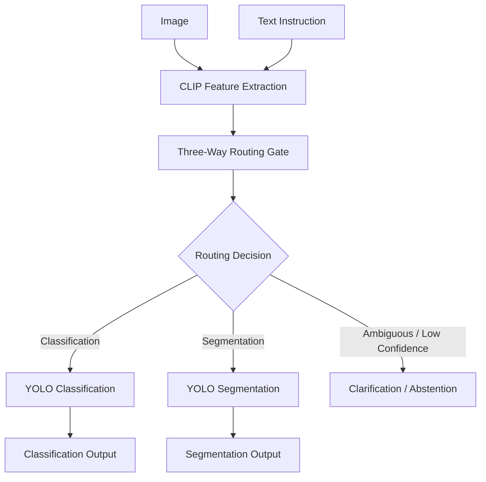
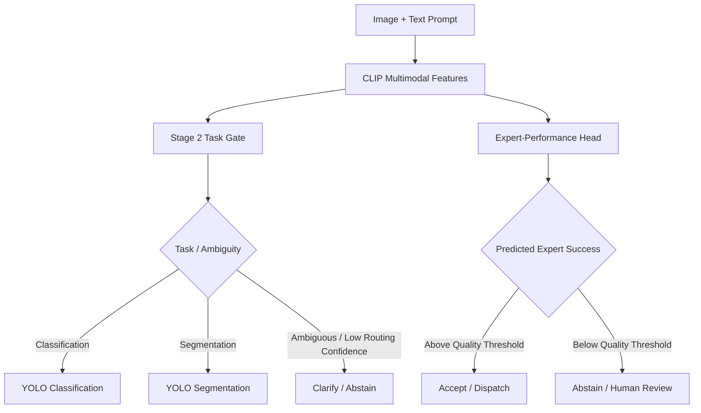
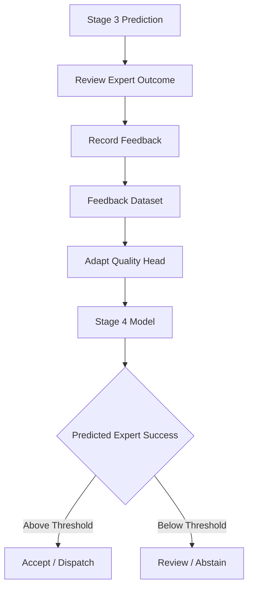

# MoE-cls-seg

A multimodal **Mixture of Experts (MoE)** system that accepts an image and a natural-language instruction, determines the requested task, and routes the input to the appropriate vision expert.

The project combines CLIP-based image and text feature extraction with specialized YOLO models for classification and segmentation. Across four progressive stages, the system evolves from basic task-based routing to confidence-aware decisions, expert-performance prediction, and feedback-driven adaptation.

---

## 1. Project Overview

The system consists of the following components:

- **Multimodal Gate:** Processes image and text features to determine the requested task.
- **Classification Expert:** A YOLO classification model that predicts the pet breed or category.
- **Segmentation Expert:** A YOLO segmentation model that identifies and segments objects in an image.
- **Confidence and Performance Prediction:** Estimates whether a routing decision is reliable and whether the selected expert is likely to succeed.
- **Feedback Adaptation:** Uses reviewed expert outcomes to update the expert-performance prediction head.

The architecture uses hard routing: the gate selects an expert rather than combining the predictions of multiple experts.

## 2. Overall Architecture



The later stages extend this architecture with expert-performance prediction and feedback-based adaptation.

---

## 3. Project Structure

```text
MoE-cls-seg/
│
├── Multimodal_MoE_Tutorial.ipynb
├── Stage2_Confidence_Aware_MoE.ipynb
├── Stage3_Expert_Performance_Aware_MoE.ipynb
├── Stage4_Feedback_Driven_Adaptive_MoE.ipynb
│
├── moe_inference.py
├── moe_confidence_inference.py
│
├── artifacts/
│   ├── router.pt
│   ├── classification_best.pt
│   ├── segmentation_best.pt
│   ├── router_confidence_aware.pt
│   ├── moe_confidence_config.json
│   ├── router_performance_aware.pt
│   ├── moe_performance_aware_config.json
│   ├── router_feedback_adaptive.pt
│   └── moe_feedback_adaptive_config.json
│
├── feedback/
│   ├── feedback_log_template.csv
│   └── feedback_log.csv
│
└── README.md
```

The `artifacts/` directory stores trained model checkpoints and configuration files. The `feedback/` directory stores the feedback template and, optionally, reviewed prediction outcomes.

The exact contents depend on which stages have been executed.

---

# 4. Stage 1 – Multimodal Task-Based Routing

**Notebook:** `Multimodal_MoE_Tutorial.ipynb`

Stage 1 introduces the fundamental Mixture of Experts architecture.

The model receives an image and a text instruction, extracts multimodal features using CLIP, and uses a trainable gating network to select the appropriate YOLO expert.

### Architecture



### Functionality

- Uses pretrained CLIP to extract image and text embeddings.
- Combines multimodal features and passes them through a trainable MLP gate.
- Trains the gate to distinguish between classification and segmentation requests.
- Uses two independent YOLO models as task-specific experts.
- Routes each request to the selected expert.
- Supports expert training and dataset preparation.
- Saves the gate and expert checkpoints for reuse.
- Demonstrates inference and segmentation visualization.

### What You Will Learn

- Fundamentals of Mixture of Experts architectures.
- Multimodal feature extraction using CLIP.
- Combining image and text representations.
- Training a gating network for task selection.
- Integrating independently trained vision models.
- Saving and loading model checkpoints.
- Performing inference using a unified model interface.

### Main Outputs

| File | Description |
|---|---|
| `router.pt` | Trained multimodal gating network. |
| `classification_best.pt` | Trained YOLO classification expert. |
| `segmentation_best.pt` | Trained YOLO segmentation expert. |

**Key takeaway:** Stage 1 establishes the basic MoE system, where a multimodal gate decides which specialist model should handle a request.

---

# 5. Stage 2 – Confidence-Aware Routing

**Notebook:** `Stage2_Confidence_Aware_MoE.ipynb`

Stage 2 extends the original architecture by introducing confidence-aware routing and an explicit clarification mechanism.

Instead of always selecting an expert, the gate can now recognize ambiguous instructions and abstain from making a routing decision.

The Stage 1 experts are reused, while the original two-output gate is expanded to support three routing decisions.

### Routing Decisions

| ID | Decision | Description |
|---|---|---|
| 0 | Classification | Route to the YOLO classification expert. |
| 1 | Segmentation | Route to the YOLO segmentation expert. |
| 2 | Clarification | Abstain because the request is ambiguous. |

Clarification is a routing decision, not a third expert.

### Architecture



### Functionality

- Reuses the pretrained Stage 1 CLIP encoder and gating network.
- Expands the routing head from two outputs to three.
- Fine-tunes the gate using classification, segmentation, and ambiguous instructions.
- Applies temperature scaling to calibrate routing probabilities.
- Evaluates routing accuracy, negative log-likelihood (NLL), and Expected Calibration Error (ECE).
- Generates reliability diagrams to inspect calibration.
- Introduces confidence thresholds for selective routing.
- Inspects the selected YOLO expert's output confidence as a separate quality signal.
- Saves the confidence-aware router and its configuration.

### What You Will Learn

- Why confidence matters in routing systems.
- How to introduce abstention into an MoE architecture.
- How to extend a pretrained gating network.
- How temperature scaling works.
- How to evaluate probability calibration using ECE and NLL.
- How confidence thresholds affect coverage and accepted accuracy.
- How to distinguish routing confidence from expert-output confidence.

### Main Outputs

| File | Description |
|---|---|
| `router_confidence_aware.pt` | Three-way confidence-aware routing checkpoint. |
| `moe_confidence_config.json` | Routing, calibration, and threshold configuration. |

The Stage 1 YOLO expert checkpoints remain unchanged.

**Key takeaway:** Stage 2 introduces the ability to recognize ambiguous requests and avoid dispatching inputs when the routing decision is not sufficiently confident.

---

# 6. Stage 3 – Expert-Performance-Aware Routing

**Notebook:** `Stage3_Expert_Performance_Aware_MoE.ipynb`

Stage 3 introduces an additional level of decision-making: predicting whether the selected expert is likely to produce a successful result.

Stage 2 estimates whether the task request is clear and whether the routing decision is sufficiently confident. Stage 3 builds on this by learning from the actual observed outcomes of the YOLO experts.

A new expert-performance prediction head is added to the Stage 2 architecture. It estimates the probability of success for the expert associated with the requested task.

### Architecture



### Functionality

- Reuses the Stage 1 YOLO classification and segmentation experts.
- Loads the Stage 2 confidence-aware routing gate.
- Runs both experts against images with available ground-truth annotations.
- Generates task-specific success labels:
  - Classification success is based on top-1 prediction correctness.
  - Segmentation success is based on foreground Intersection over Union (IoU) meeting a configured threshold.
- Adds a two-output expert-performance prediction head.
- Trains the new head using observed expert outcomes.
- Keeps CLIP and the Stage 2 task-routing gate frozen.
- Evaluates quality prediction using Brier score and Expected Calibration Error (ECE).
- Generates reliability diagrams.
- Studies the relationship between quality thresholds, coverage, and accepted success rate.
- Combines Stage 2 routing confidence with predicted expert success in the inference policy.

### How Stage 3 Works

The inference policy applies two sequential checks.

**1. Task and routing confidence**

The Stage 2 gate determines whether the request is classification, segmentation, or ambiguous. Requests that are ambiguous or have insufficient routing confidence are rejected for clarification.

**2. Predicted expert performance**

For a clear task, the Stage 3 performance head estimates the probability that the corresponding expert will meet its task-specific success criterion.

- If predicted success is above the configured quality threshold, the request is accepted and sent to the selected expert.
- If predicted success is below the threshold, the system abstains and marks the request for review.

The system does not silently switch to the other expert when predicted performance is low.

### What You Will Learn

- How to evaluate expert performance using ground-truth annotations.
- How to generate task-specific success and failure labels.
- How to train an auxiliary prediction head.
- How to predict the probability of expert success.
- How to evaluate probability predictions using Brier score and ECE.
- How to interpret reliability diagrams.
- How to analyze the trade-off between coverage and accepted success rate.
- How to combine task routing, routing confidence, and predicted expert performance.

### Main Outputs

| File | Description |
|---|---|
| `router_performance_aware.pt` | Stage 2 routing gate combined with the trained expert-performance head. |
| `moe_performance_aware_config.json` | Model, expert, and threshold configuration. |

The Stage 1 YOLO checkpoints remain unchanged and are reused.

**Key takeaway:** Stage 3 moves beyond asking whether the gate selected the correct task. It also estimates whether the selected expert is likely to succeed at that task.

---

# 7. Stage 4 – Feedback-Driven Adaptive MoE

**Notebook:** `Stage4_Feedback_Driven_Adaptive_MoE.ipynb`

Stage 4 introduces a feedback loop to the Stage 3 system.

Reviewed outcomes from completed predictions are recorded and used to adapt the expert-performance prediction head. This allows the system to incorporate additional observations and update its estimates of expert success.

Only the Stage 3 quality head is fine-tuned. CLIP, the three-way task-routing gate, and both YOLO experts remain frozen.

### Architecture



### Feedback Sources

The notebook supports two feedback sources:

**1. Ground-truth bootstrap feedback**

Automatically generates task-specific success/failure labels using Oxford-IIIT Pet annotations. This provides a reproducible way to demonstrate the feedback workflow.

**2. Reviewed prediction feedback**

Loads additional examples that have been reviewed and recorded in `feedback_log.csv`.

### Functionality

- Creates a persistent CSV format for reviewed expert outcomes.
- Loads and validates feedback records.
- Supports ground-truth-derived bootstrap feedback.
- Splits feedback by source image to avoid image-level overlap between training and evaluation subsets.
- Evaluates the Stage 3 model as a baseline.
- Fine-tunes only the expert-performance prediction head.
- Compares Stage 3 and Stage 4 quality predictions.
- Evaluates calibration and selective coverage.
- Saves the adapted model and configuration.
- Provides a helper function for recording reviewed predictions.

### Feedback CSV Format

The feedback file uses the following columns:

| Column | Description |
|---|---|
| `image_path` | Path to the image used for inference. |
| `prompt` | Original natural-language instruction. |
| `task_id` | `0` for classification, `1` for segmentation. |
| `success` | `1` for success, `0` for failure after review. |
| `source_id` | Stable identifier for the source image. |

A consistent `source_id` should be used for all tasks associated with the same source image.

### What You Will Learn

- How to create a feedback dataset from observed expert outcomes.
- How to record task-specific success and failure labels.
- How to build a repeatable feedback ingestion workflow.
- How to fine-tune an auxiliary prediction head using new observations.
- How to prevent source-image leakage during feedback evaluation.
- How to compare model predictions before and after adaptation.
- How feedback can affect calibration and selective coverage.

### Main Outputs

| File | Description |
|---|---|
| `router_feedback_adaptive.pt` | Stage 4 model with the adapted expert-performance head. |
| `moe_feedback_adaptive_config.json` | Model, expert, threshold, and feedback configuration. |
| `feedback_log_template.csv` | Empty template for reviewed feedback. |
| `feedback_log.csv` | Optional file containing reviewed outcomes. |

**Key takeaway:** Stage 4 introduces a repeatable feedback-based adaptation process. The system can use reviewed outcomes to update its expert-performance predictions without retraining the underlying vision experts or task-routing gate.

---

# 8. Comparison Across All Four Stages

| Feature | Stage 1 | Stage 2 | Stage 3 | Stage 4 |
|---|:---:|:---:|:---:|:---:|
| Image and text input | Yes | Yes | Yes | Yes |
| CLIP feature extraction | Yes | Yes | Yes | Yes |
| YOLO classification expert | Yes | Yes | Yes | Yes |
| YOLO segmentation expert | Yes | Yes | Yes | Yes |
| Task-based routing | Yes | Yes | Yes | Yes |
| Ambiguity detection | No | Yes | Yes | Yes |
| Confidence-aware abstention | No | Yes | Yes | Yes |
| Temperature scaling | No | Yes | Reuses Stage 2 | Reuses Stage 2 |
| Expert-performance prediction | No | No | Yes | Yes |
| Ground-truth expert outcome labels | No | No | Yes | Optional bootstrap |
| Feedback-based adaptation | No | No | No | Yes |
| Quality-head fine-tuning | No | No | Yes | Yes |
| Feedback ingestion | No | No | No | Yes |
| Coverage and reliability analysis | Basic routing evaluation | Yes | Yes | Yes |

---

# 9. Inference

The project includes standalone Python modules for running inference outside Jupyter notebooks.

| File | Purpose |
|---|---|
| `moe_inference.py` | Loads the Stage 1 gate and YOLO experts for task-based inference. |
| `moe_confidence_inference.py` | Loads the Stage 2 confidence-aware gate and YOLO experts for confidence-aware inference. |

Stage 3 and Stage 4 inference are demonstrated inside their respective notebooks. Their saved checkpoints and configurations provide the basis for extending standalone deployment.

For inference, keep the required checkpoint files together in the configured `artifacts/` directory.

---

# 10. Installation and Execution

The notebooks are designed to support execution on:

- Google Colab
- Linux
- Windows
- macOS

### Hardware Support

The notebooks automatically detect the available compute device:

| Hardware | PyTorch Device |
|---|---|
| NVIDIA GPU | CUDA |
| Apple Silicon GPU | MPS |
| CPU | CPU |

Google Colab users can optionally mount Google Drive to persist datasets, checkpoints, and generated artifacts between sessions.

### Recommended Execution Order

Run the notebooks in sequence:

1. `Multimodal_MoE_Tutorial.ipynb`
2. `Stage2_Confidence_Aware_MoE.ipynb`
3. `Stage3_Expert_Performance_Aware_MoE.ipynb`
4. `Stage4_Feedback_Driven_Adaptive_MoE.ipynb`

Each stage builds on the artifacts generated by previous stages. Ensure the required checkpoints are available in the configured `artifacts/` directory before proceeding.

---

# 11. Important Limitations

- **Stage 1:** The gate primarily learns to recognize the requested task from image and text features. It does not learn to compare the actual performance of the experts.
- **Stage 2:** Ambiguity handling is trained using supervised prompt labels. The system does not independently establish whether every real-world instruction is ambiguous.
- **Stage 2:** Softmax confidence is not an out-of-distribution detector. An unfamiliar prompt can still receive a high confidence score.
- **Stage 2:** Classification confidence and segmentation confidence are task-specific signals and should not be treated as directly comparable.
- **Stage 3:** The performance head predicts whether the selected expert will meet a defined task-specific success criterion. It does not compare the two experts as interchangeable alternatives.
- **Stage 3:** Classification and segmentation use different success definitions: top-1 correctness and foreground IoU, respectively.
- **Stage 4:** Feedback adaptation updates only the expert-performance prediction head. It does not retrain the YOLO experts, CLIP encoder, or Stage 2 task-routing gate.
- **Stage 4:** Feedback adaptation does not guarantee improvement. Feedback may be noisy, sparse, or unrepresentative.
- **Stage 4:** Ground-truth bootstrap feedback is proxy feedback, not human review. New feedback is incorporated by rerunning the notebook; adaptation does not happen continuously in the background.
- **Dataset evaluation:** The Oxford-IIIT Pet test split was used in earlier stages for checkpoint selection and calibration/evaluation. Consequently, later-stage results are intended as a progressive learning demonstration, not a pristine independent benchmark. A new untouched test set is needed for a rigorous final evaluation.
- **Thresholds:** Routing and quality thresholds are application-dependent. Their values should be evaluated against the desired balance between coverage and reliability.

---

# 12. Learning Outcomes

By completing all four stages, you will gain practical experience with:

1. Multimodal learning using image and text inputs.
2. CLIP-based feature extraction.
3. Mixture of Experts architecture and task-specific routing.
4. Integration of YOLO classification and segmentation models.
5. Confidence-aware routing and abstention.
6. Probability calibration using temperature scaling.
7. Expert-performance prediction using observed outcomes.
8. Brier score, Expected Calibration Error, and reliability diagrams.
9. Selective prediction and coverage analysis.
10. Feedback dataset construction and validation.
11. Fine-tuning auxiliary prediction heads.
12. Comparing model behavior before and after feedback adaptation.
13. Saving, loading, and reusing trained model checkpoints.

---

# 13. Conclusion

This project demonstrates the progressive development of a multimodal Mixture of Experts system across four stages.

- **Stage 1:** Learns to route image and text inputs to the appropriate task-specific expert.
- **Stage 2:** Introduces confidence-aware routing and an explicit clarification mechanism.
- **Stage 3:** Learns to estimate whether the selected expert is likely to produce a successful result.
- **Stage 4:** Incorporates reviewed outcomes to adapt expert-performance predictions.

Together, these stages provide a practical exploration of multimodal routing, specialized vision models, confidence calibration, performance prediction, and feedback-driven adaptation.