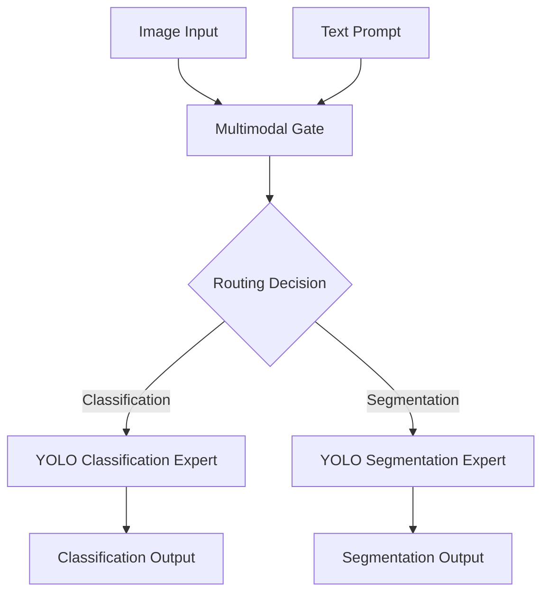
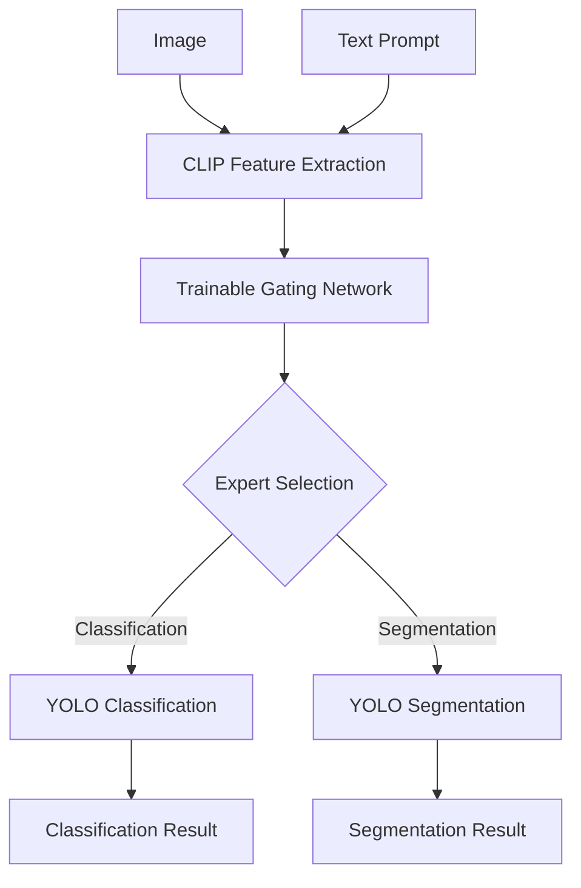
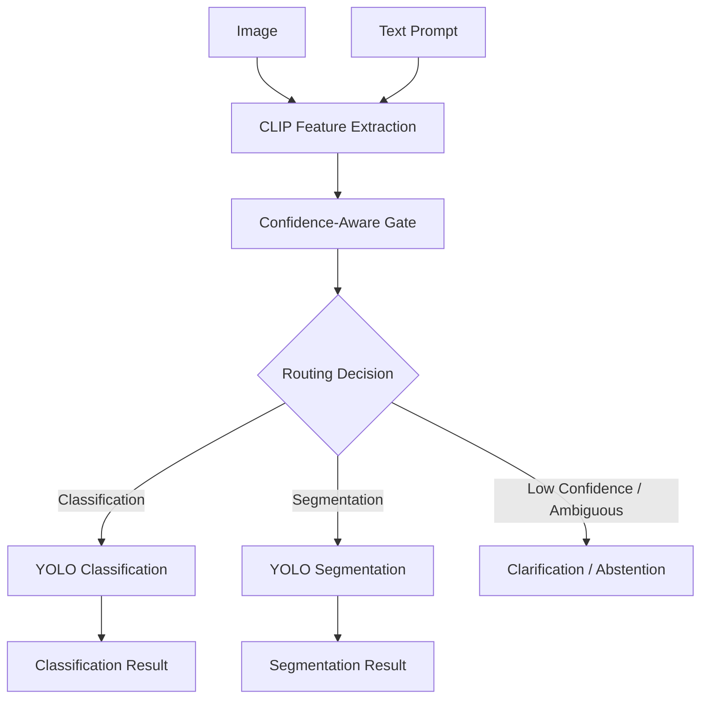

# MoE-cls-seg

A multimodal Mixture of Experts (MoE) model that accepts both image and text inputs and dynamically routes each request to the appropriate expert. The project combines image understanding with text-based task instructions to determine whether classification or segmentation is required.

## Overview

The project uses a multimodal gating network to interpret an image and a text prompt, then selects the most appropriate task-specific expert:

- **Classification Expert:** Performs image classification.
- **Segmentation Expert:** Performs object segmentation.
- **Multimodal Gate:** Uses image and text features to determine which expert should handle the request.

The project is developed in two stages, progressively introducing more advanced routing capabilities.

## Architecture



## Project Structure

```text
MoE-cls-seg/
│
├── Multimodal_MoE_Tutorial.ipynb
├── Stage2_Confidence_Aware_MoE.ipynb
├── moe_inference.py
├── moe_confidence_inference.py
├── README.md
│
└── ...
```

## Stage 1 – Multimodal Task Routing

**Notebook:** `Multimodal_MoE_Tutorial.ipynb`

Stage 1 introduces the core Mixture of Experts architecture. A multimodal gate receives an image and a text instruction, extracts their features using a pretrained CLIP model, and predicts which expert should process the request.

### Functionality

- Uses CLIP to extract image and text features.
- Trains a gating network to select between classification and segmentation.
- Uses separate YOLO models as task-specific experts.
- Routes incoming requests to the selected expert.
- Saves the trained gate and expert weights for later inference.

### What You Will Learn

- The fundamentals of Mixture of Experts architectures.
- How multimodal image and text features can be combined.
- How a gating network selects task-specific experts.
- How to integrate independently trained models into a unified system.
- How to save and reuse trained model weights.

### Stage 1 Architecture



## Stage 2 – Confidence-Aware Routing

**Notebook:** `Stage2_Confidence_Aware_MoE.ipynb`

Stage 2 builds upon the Stage 1 architecture by introducing confidence-aware routing. Instead of always selecting an expert, the gate can now decide that a request is ambiguous and should be clarified rather than automatically routed.

The Stage 1 experts are reused, while the gating network is extended and fine-tuned to support an additional routing decision.

### Functionality

- Extends the gate to support three decisions:
  - Classification
  - Segmentation
  - Clarification / Abstention
- Fine-tunes the gating network using task and ambiguity labels.
- Applies temperature scaling to calibrate routing probabilities.
- Evaluates routing performance using accuracy, negative log-likelihood (NLL), and Expected Calibration Error (ECE).
- Measures selective prediction performance using coverage and accepted accuracy.
- Introduces confidence thresholds to determine whether a request should be processed or rejected for clarification.

### What You Will Learn

- Why confidence matters in Mixture of Experts systems.
- How to introduce abstention into a routing architecture.
- How temperature scaling can improve probability calibration.
- How to evaluate model calibration using ECE and NLL.
- How confidence thresholds affect coverage and accepted accuracy.
- How to build more cautious routing systems that can decline uncertain requests.

### Stage 2 Architecture



## Stage Comparison

| Feature | Stage 1 | Stage 2 |
|---|---|---|
| Image and text input | Yes | Yes |
| CLIP feature extraction | Yes | Yes |
| Classification expert | Yes | Yes |
| Segmentation expert | Yes | Yes |
| Trainable gating network | Yes | Yes |
| Task-based routing | Yes | Yes |
| Ambiguity handling | No | Yes |
| Confidence-aware abstention | No | Yes |
| Temperature scaling | No | Yes |
| Calibration evaluation | No | Yes |

## Inference

The project includes standalone Python modules to use the trained models outside Jupyter notebooks.

| File | Purpose |
|---|---|
| `moe_inference.py` | Runs inference using the Stage 1 multimodal gate and YOLO experts. |
| `moe_confidence_inference.py` | Runs inference using the Stage 2 confidence-aware gate and YOLO experts. |

The Stage 2 inference module requires the confidence-aware router checkpoint and configuration generated by the Stage 2 notebook, in addition to the Stage 1 expert weights.

## Requirements

The notebooks are designed to support execution on:

- Google Colab
- Linux
- Windows
- macOS

The execution device is selected automatically based on available hardware, supporting CUDA, Apple Metal (MPS), and CPU.

## Learning Objectives

By completing both stages, you will explore:

1. Multimodal learning with image and text inputs.
2. Mixture of Experts architecture and task-specific expert selection.
3. CLIP-based feature extraction.
4. Integration of YOLO classification and segmentation models.
5. Confidence-aware routing and abstention.
6. Probability calibration and selective prediction.
7. Model checkpointing and standalone inference.

## Limitations

- Stage 1 routing is trained primarily to recognize the requested task from the image and text inputs; it does not learn to compare the actual performance of the experts.
- Stage 2 learns to identify ambiguous requests using supervised routing labels. It does not dynamically benchmark both experts before selecting one.
- Classification confidence and segmentation confidence are task-specific signals and should not be directly compared.
- Confidence calibration depends on the quality and representativeness of the calibration data.

## Conclusion

This project demonstrates the development of a multimodal Mixture of Experts system, progressing from basic task-conditioned routing to confidence-aware routing with an abstention mechanism.

It provides a practical introduction to combining specialized vision models through a shared multimodal gating network, while exploring how confidence and calibration can make routing decisions more reliable.